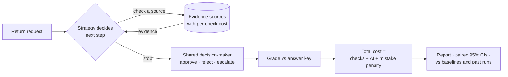

<div align="center">


# Yantraa

**Your returns agent checks every record before it decides. Most of those checks don't change the answer.**

Yantraa measures how many checks an AI can skip, what that saves per decision, and whether accuracy holds — with
paired confidence intervals, on your cost assumptions, in one command.


**[Yantraa website →](https://shalihotri.github.io/Yantraa/)** Explore the vision for industry-specific agentic workflows.
**[Evidence lab →](https://shalihotri.github.io/Yantraa/evidence.html)** See a decision graph fill in check by check,
and compare strategies on cost and accuracy. [Vercel deployment instructions](showcase/README.md#deploy-to-vercel).

</div>

---

<!-- ===================================================================================
     [FILL] after the live run (Day 3–4). Replace every bracketed value below with the
     real number from `yantraa evaluate`. Delete this comment block before publishing.
     =================================================================================== -->

## The finding

On **[N]** product-return decisions with a realistically skewed label mix (**[~90% approve / ~8% reject / ~2% escalate]**),
letting the model choose which evidence to fetch (`selective`) compared with fetching everything (`fetch_all`):

| | `fetch_all` (baseline) | `selective` | Difference (95% CI, paired) |
|---|---|---|---|
| Checks per decision | **[x.x]** | **[x.x]** | **[−x.x (−a.a to −b.b)]** |
| Cost per decision (checks + model + mistake penalty) | **[$0.xx]** | **[$0.xx]** | **[−xx% (−aa% to −bb%)]** |
| Accuracy | **[xx.x%]** | **[xx.x%]** | **[+x.x pp (−a.a to +b.b)]** |
| Wrong approvals (the expensive mistake) | **[n]** | **[n]** | **[…]** |


**Where it stops being true.** The winner flips when a wrong approval costs more than **[k×]** the default penalty —
see the sensitivity chart below. **[One sentence on the most surprising or negative thing you saw.]**


Model: **[model name]** · Run ID: **[b_2026…]** · Full method and caveats: [docs/design.md](docs/design.md) ·
Reproduce: `yantraa evaluate [b_2026…]`

---

## Try it in 60 seconds

No API key, no config, nothing leaves your machine. The offline mock reproduces the mechanics, not model quality.

```bash
pip install yantraa-evidence
yantraa experiment --limit 40      # runs every strategy on 40 cases (data generated on first run)
yantraa evaluate                   # scoreboard, paired verdicts vs fetch_all, caveats
```

Or without installing anything: `uvx --from yantraa-evidence yantraa experiment --limit 40`

<!-- [FILL] Once `yantraa demo` ships (Day 6–7), replace the three lines above with:
     pip install yantraa-evidence && yantraa demo
     and add the 20-second GIF here:  -->

**Run it with a real model** (check spend first — it prints worst-case calls and dollars before anything runs):

```bash
echo "OPENAI_API_KEY=sk-..." > .env
yantraa experiment --provider openai --limit 50 --estimate-only
yantraa experiment --provider openai --limit 50
yantraa evaluate
```

**Run it on your own decisions:** write your cases to `data/returns/dev.jsonl` with the correct answer in
`oracle_action`, set your real check costs and mistake penalties in `config/default.yaml`, and run the same two
commands. See [Bring your own domain](#bring-your-own-domain) for anything that isn't product returns.

---

## Why this exists

Before an AI approves, rejects or escalates a return, it fetches records: order history, inspection photos, prior
disputes. Each fetch costs money and latency. Each wrong decision costs more. Teams end up in one of two places:

- **Fetch everything.** Safe, slow, and the per-decision cost makes finance nervous.
- **Fetch nothing.** Cheap, and risk won't sign off on it.

The interesting question is whether a model can *choose* what to check, stop when it has enough, and stay as accurate
as the exhaustive version. Yantraa answers that with a controlled, paired comparison rather than a demo.



**Built-in strategies:** `selective` (the model picks the next check — the idea under test), `fetch_all` (reference
baseline), `fixed_order` (checklist, stop early), `confidence_threshold` (stop when the model is sure) and
`initial_only` (no checks — the lower bound).

**What keeps the comparison honest:**

- 🔒 **Strict information boundary.** The decision-maker sees only what was fetched — never the answer key or unfetched records. Tests enforce it.
- ⚖️ **Same judge for every strategy.** One decision-maker, one prompt, one set of limits.
- 🧯 **Fails safe and loudly.** Limits are checked before each call. Any failure returns the fallback label (`escalate`) with the reason recorded. No silent retries.
- 📏 **Paired statistics.** Seeded bootstrap intervals, case-by-case. Penalty sensitivity from 0.25× to 4×. Unknown prices reported as *unknown*, never zero.
- 🧾 **Reproducible.** Every run stores its config hash, seed, data and prompt versions, model version and full trace.

**Also works for:** insurance claims triage (example included), chargebacks, AML/KYC alerts, loan exceptions,
prior authorizations, billing disputes, delivery claims, access requests — any decision where checking costs money
and being wrong costs more. Per-industry sources and penalties: [docs/use-cases.md](docs/use-cases.md).

---

## Python API

Three building blocks. Use them from a script, a notebook or the CLI, and build whatever UI you want on top.

**Overview** — what's available: domain, sources and costs, strategies, providers, data, saved results.

```python
from yantraa_evidence import overview
from yantraa_evidence.overview import to_text
print(to_text(overview()))
```

**Experiment** — design and run a comparison on your economics.

```python
from yantraa_evidence import Experiment

exp = Experiment(
    domain="returns",
    split="dev",                         # tune on dev; keep test locked until the end
    strategies=["selective", "fixed_order", "fetch_all"],
    provider="mock",                     # or "openai" / "openai-responses"
    limit=40,
    overrides={"costs": {"get_inspection": 0.25}, "loss": {"approve": 50}},
)
print(exp.estimate())                    # worst-case calls and spend before anything runs
result = exp.run()                       # scored, saved to SQLite, exported to CSV / JSONL / JSON
trace = exp.run_case(0, "selective")     # one decision, fully traced
```

**Evaluate** — score against baselines and earlier runs.

```python
from yantraa_evidence import evaluate, compare_to_baseline

report = evaluate(result)                 # or evaluate("b_2026...") for a saved run
print(report.to_text())
report.metrics                            # accuracy, wrong_<label>, fallback_rate, checks, costs, latency
report.paired_comparisons                 # each strategy minus the baseline, with 95% intervals
report.penalty_sensitivity                # does the winner change if mistakes cost 0.25x to 4x?
compare_to_baseline(new_result, "b_2026...")   # regression check: new prompt / model vs a saved benchmark
```

**Add a strategy** in a few lines; it becomes available to `Experiment` and the CLI:

```python
from yantraa_evidence import register_strategy

@register_strategy
def cheapest_first(s):
    """Check sources cheapest-first; stop once the decision is no longer the fallback."""
    d = s.classify()
    for src in sorted(s.sources, key=lambda x: s.cfg.sources[x].cost):
        if d.action != s.domain.fallback:
            break
        s.fetch(src)
        d = s.classify()
    return d
```

**CLI equivalents:**

```bash
yantraa overview [--json] [--problems 20]
yantraa experiment --split dev --strategies selective,fetch_all --limit 40
yantraa experiment --case 0 --strategies selective        # one traced decision
yantraa experiment --generate --seed 7                    # regenerate synthetic cases
yantraa evaluate [b_ID] [--against b_OLD] [--reference fixed_order] [--json] [--list]
```

---

## Bring your own domain

A domain is one class: declare sources, labels, fallback and penalties, then implement `assess`. That one function
produces the answer key *and* drives the offline mock, so the two can never disagree.

```python
from yantraa_evidence import Assessment, Domain, Source

class Chargebacks(Domain):
    name = "chargebacks"
    task = "Decide whether to accept a card chargeback."
    sources = (Source("get_transaction", "Transaction log", cost=0.01),
               Source("get_merchant_evidence", "Merchant's delivery proof", cost=0.20),
               Source("get_customer_history", "Prior disputes", cost=0.05))
    actions = {"accept": "...", "reject": "...", "review": "..."}
    fallback = "review"
    loss = {"accept": 80, "reject": 30, "review": 3}

    def assess(self, evidence):           # evidence = {source_id: [payload, ...]} for fetched sources
        ...
        return Assessment(action, conditions)
```

Use it with `Experiment(domain="my_module:Chargebacks")`, `--domain path/to/file.py:DOMAIN`, or
`register_domain(Chargebacks())`.

- **Data:** implement `generate(seed)` for synthetic cases, or write `Case` records (correct answer in `oracle_action`)
  to `data/<domain>/<split>.jsonl`, or pass `Experiment(cases=[...])`.
- **Worked example:** [examples/insurance_claims.py](examples/insurance_claims.py) — claims triage with a generator, runs in CI.
- **Another model:** implement `select(obs)` and `classify(obs)`, then pass `Experiment(adapter_factory=...)`.

---

## Configuration

| What | Where |
|---|---|
| API key and model overrides | `.env` (copy [`.env.example`](.env.example)); git-ignored |
| Domain, source costs, mistake penalties, limits, threshold, paths | [`config/default.yaml`](config/default.yaml), or `Experiment(overrides=...)` per run |
| Model prices (USD per 1M tokens) | [`config/pricing.yaml`](config/pricing.yaml); missing prices are reported as *unknown* |

Unknown source or label names fail loudly instead of being ignored.

## Architecture

```
src/yantraa_evidence/
  overview.py      what is available (domains, strategies, providers, data, results)
  experiment.py    Experiment / ExperimentResult: design, estimate, run, save
  evaluate.py      scoring, metrics, paired bootstrap, sensitivity, Report, compare_to_baseline
  domain.py        Domain / Source / Assessment base classes and the registry
  domains/         built-in domains (returns, with a seeded generator)
  strategies.py    built-in strategies + @register_strategy
  adapters.py      decision-makers: mock (offline) and OpenAI (Decisions, Responses)
  runner.py        guarded execution engine: Session, limits, validation, tracing
  tools.py         case-data-backed evidence tools (same interface a live connector would use)
  datasets.py      case files (JSONL) and synthetic data generation
  storage.py       SQLite results + evidence graph, CSV/JSONL/JSON export
  schemas.py       typed contracts: Case, Observation, decisions, RunResult
  config.py        YAML config, domain defaults, pricing, .env
  logtracker.py    structured "what went wrong" log (keys redacted)
  cli.py           yantraa overview | experiment | evaluate
examples/          quickstart.py · insurance_claims.py
docs/              design.md (method, guarantees, findings log) · use-cases.md
tests/             isolation, limits, failures, graph round-trip, known answers, custom domains, CLI
```

Read [docs/design.md](docs/design.md) before citing a result.

## Development

```bash
git clone https://github.com/Shalihotri/Yantraa.git && cd Yantraa
uv sync                                    # env with dev tools
uv run pytest                              # all tests, offline, no API key
uv run ruff check src tests examples
uv build
```

CI ([`.github/workflows/ci.yml`](.github/workflows/ci.yml)) runs lint and tests on Linux and Windows for Python 3.11
and 3.12, the full Overview → Experiment → Evaluate flow offline for both domains, a wheel-install smoke test and a
secret scan. See [CONTRIBUTING.md](CONTRIBUTING.md).

## Privacy & security

- **Everything runs locally.** No server, no account, no telemetry.
- **Your API key stays on your machine.** Read from the environment or `.env`; never logged or stored. Provider errors are redacted. `.env`, databases, logs and results are git-ignored.
- **Only live decision-makers send data out.** With `--provider openai`, fetched evidence for each case goes to OpenAI (`store=False` where supported). The mock sends nothing.
- **Bundled data is synthetic.** No real people, orders or personal information. If you use real records, anonymise them and keep them in a git-ignored folder (e.g. `private/`).

## Limitations

- **[FILL — update after Day 2]** Bundled data is synthetic. **[It is skewed to ~90/8/2 to resemble a production mix, but it is still generated, not observed.]**
- Default mistake penalties are illustrative. Set your own and read the sensitivity table.
- The mock uses the same rule as the answer key: it validates mechanics, not model quality.
- A model's stated confidence is not calibrated correctness. The tool supports comparisons, not causal claims.
- Live results are from a single run on one model. See the [findings log](docs/design.md#findings-log) for what has and hasn't replicated.

## Roadmap

- [ ] `yantraa demo`: zero-config run that prints the scoreboard and saves the charts
- [ ] Fast/cheap decision-maker adapters (small models and classification-only models) for the `classify()` step
- [ ] Larger live runs on the practice set, then a single locked run on the held-out set
- [ ] External validation on real, anonymised returns decision logs — if you have one, [open an issue](https://github.com/Shalihotri/Yantraa/issues)
- [ ] Live evidence connectors behind the same tool interface
- [ ] More built-in domains (chargebacks, access requests)

## Contributing

Issues and PRs welcome — read [CONTRIBUTING.md](CONTRIBUTING.md). In short: keep the information boundary intact, add
tests, and keep negative findings visible.

## License

[Apache-2.0](LICENSE).
